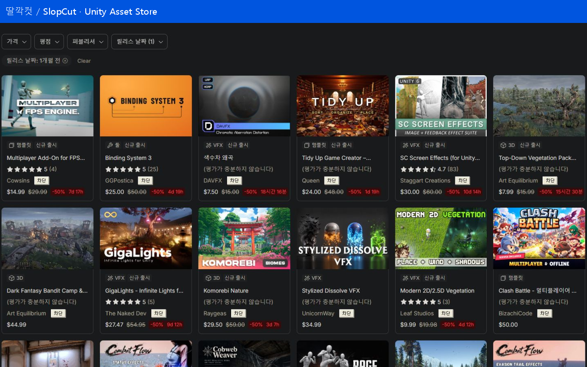
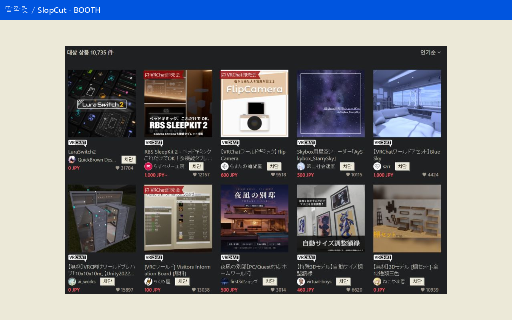
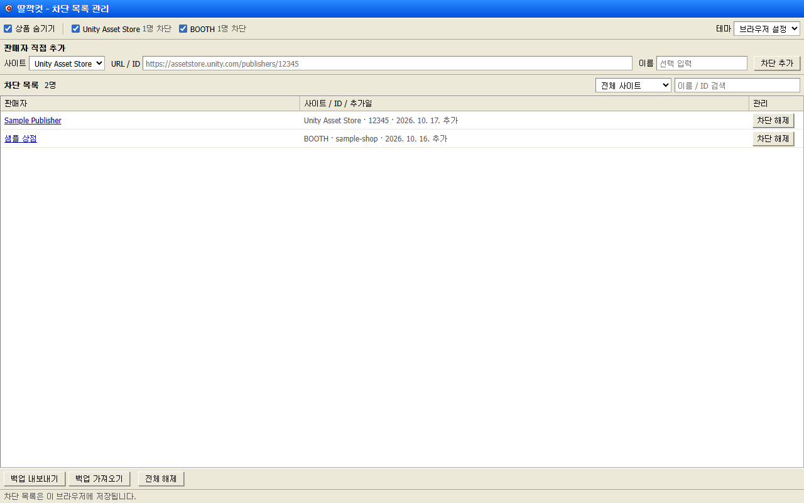
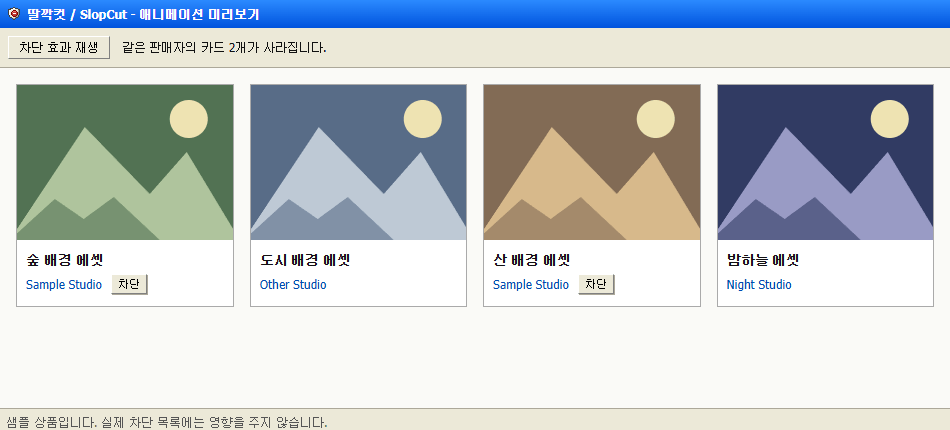

# 딸깍컷 · SlopCut

Unity 에셋스토어와 BOOTH에서 보고 싶지 않은 판매자의 상품을 숨기는 Microsoft Edge 확장입니다.

공개자: **SlopCut** · [GitHub 저장소](https://github.com/Obsihill/slopcut-extension) · [문의](https://github.com/Obsihill/slopcut-extension/issues)
판매자 이름 오른쪽 **차단**을 누르면 같은 판매자의 상품이 목록에서 사라집니다.

한국어 브라우저에는 **딸깍컷**, 그 외에는 **SlopCut**으로 표시됩니다. 현재 관리 화면의 기능 문구와 사이트의 버튼은 한국어입니다.

## 기능

- 판매자 이름 옆에서 차단: 검색·추천 목록과 상품 상세 화면 지원
- 새로 차단한 상품이 검은 재처럼 흩어지는 효과와 목록 재배치
- 사이트별 숨김 켜기/끄기, 차단 목록 검색·필터·직접 추가·해제
- JSON 백업 내보내기와 합쳐서 가져오기
- Windows XP 스타일 관리 화면, 브라우저 테마 연동과 라이트/다크 선택
- 계정 가입 없이 기기에 저장. 확장 자체의 서버, 분석·광고 SDK 없음

## 지원 사이트

| 사이트 | 판매자 구분 기준 | 지원 범위 |
|---|---|---|
| Unity Asset Store | 제작자 숫자 ID | 검색·추천 카드, 상품 상세의 제작자 |
| BOOTH | 상점 서브도메인 | 검색·카테고리·추천·상품 상세, 호환되는 개별 상점 테마 |

사이트의 HTML 구조나 개별 상점 테마에 따라 일부 위치에서는 버튼이 표시되지 않을 수 있습니다.
BOOTH 로그인·관리·결제·문의 화면은 대상으로 삼지 않습니다.
상품 목록의 전체 개수와 페이지 번호는 원래 사이트 값입니다. 숨긴 만큼 현재 페이지의 상품 수가 줄어들 수 있습니다.
이 확장은 AI 생성물 여부를 판정하지 않으며, 사용자가 직접 선택한 판매자만 숨깁니다.
판매자의 상점 URL이 바뀌면 새 상점 주소를 다시 차단해야 합니다.

## 설치

스토어 등록은 준비 중입니다. 아직 공식 스토어 설치 링크는 없습니다.

개발용 설치:

1. 이 저장소 ZIP 또는 GitHub Release의 `SlopCut-1.5.0-edge.zip`을 내려받아 압축을 풉니다.
2. Edge에서 `edge://extensions`를 열고 개발자 모드를 켭니다.
3. **압축 풀린 파일 로드**에서 `manifest.json`이 있는 폴더를 선택합니다. 소스 ZIP을 받았다면 `extension/`입니다.
4. 이미 열려 있던 Unity·BOOTH 탭을 새로고침합니다.
5. 사용 중인 설치 폴더를 삭제하거나 이동하지 마세요.

기존 SlopBlock 사용자: 기존 폴더의 파일을 새 `extension/` 내용으로 갱신한 뒤 확장과 스토어 탭을 새로고침합니다.
확장을 제거하거나 새 폴더로 다시 등록하면 별개의 확장이 될 수 있습니다. 먼저 관리 페이지에서 JSON을 백업하세요.
개발용 설치에서 스토어 설치로 옮길 때도 백업을 새 설치에 가져오면 됩니다.

## 사용

판매자 이름 옆 **차단**을 누릅니다. 목록에서는 약 0.9초의 효과 뒤 같은 판매자의 상품을 숨기며 페이지를 새로고침하지 않습니다.
상세 화면에서 주 판매자를 차단하면 효과 뒤 이전 페이지로 돌아갑니다. 이전 페이지가 없으면 스토어 홈으로 이동합니다.
차단 해제는 확장 아이콘을 눌러 여는 관리 페이지에서 할 수 있습니다.
처음부터 차단되어 있거나 다른 탭에서 차단된 판매자의 상품은 즉시 숨깁니다.
직접 클릭한 효과는 OS의 동작 줄이기 설정이 켜져 있어도 재생됩니다. 비활성 탭에서는 생략하며, 화면 내 최대 8개 영역에 적용합니다.

## 화면






스크린샷에는 실제 사이트의 공개 상품과, 관리 화면·효과 설명을 위한 예시 데이터가 포함됩니다.
표시된 상품과 판매자를 추천·평가하는 의미가 아닙니다.

## 개발

확장 실행에는 빌드나 외부 라이브러리가 필요 없습니다. `extension/`을 그대로 로드합니다.
개발 도구는 Node.js 22.13 이상과 Python 3.10 이상을 사용합니다.

```sh
npm install
npm test
npx playwright install chromium
npm run test:browser
npm run check
npm run package
```

Windows의 설치된 Edge로 브라우저 테스트를 하려면 PowerShell에서 `$env:BROWSER_CHANNEL='msedge'; npm run test:browser`를 실행합니다.
생성된 패키지는 `dist/`에 있습니다. 공개자 정보를 설정하려면 `python scripts/configure-publication.py --owner YOUR_GITHUB_LOGIN --publisher "공개자 표시명"`을 실행합니다.
이 명령은 공개·업로드를 수행하지 않습니다.

## 문서

- [English overview](docs/README.en.md)
- [개인정보처리방침](docs/privacy.md) · [웹 게시용](docs/privacy.html)
- [구조와 사이트 추가](docs/ARCHITECTURE.md)
- [Edge 제출 안내](docs/store/SUBMISSION.md)
- [한글 소개문](docs/store/ko-KR.txt) · [영문 소개문](docs/store/en-US.txt)
- [기여 안내](CONTRIBUTING.md) · [변경 기록](CHANGELOG.md)

## 라이선스

[MIT 라이선스](LICENSE) · Copyright (c) 2026 SlopCut.
사이트 스크린샷의 상품 이미지·로고·판매자 콘텐츠 권리는 각 권리자에게 있습니다.
Unity·BOOTH·Microsoft와 제휴하거나 공식 제공하는 확장이 아닙니다.
